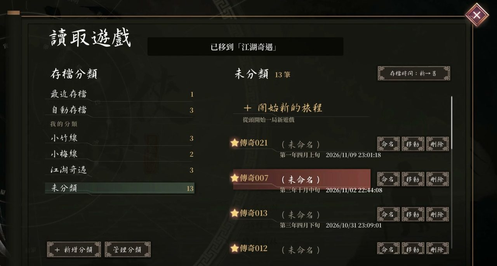
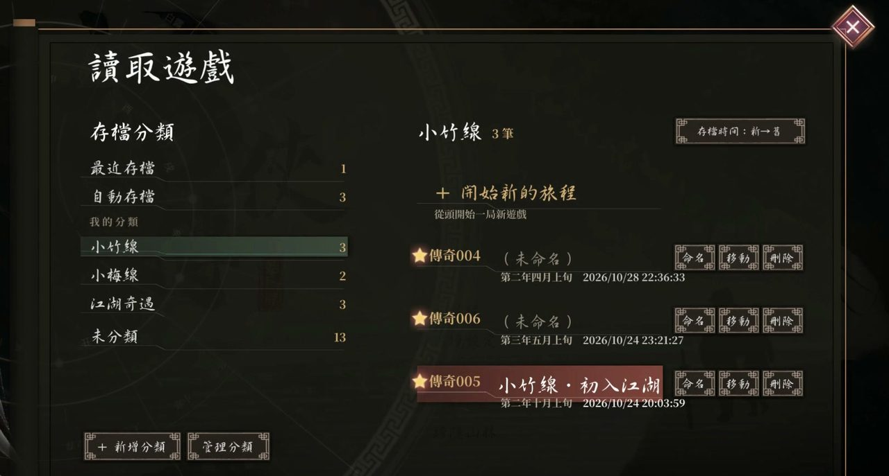

# LoM Save Manager（活俠傳存檔管理）

讓《活俠傳》存檔不再只有 20 格，可命名、可自訂分類（像資料夾）。僅限 Windows Steam 版，需 BepInEx 6。

**[下載最新版](https://github.com/Lawa0921/lom-save-manager/releases/latest) · [安裝教學](#安裝方式) · [圖文介紹](https://www.supergalen.com/journal/2026-11-10-legend-of-mortal-save-manager-mod/) · [Discord](https://discord.gg/QRyTagwSSF)**

## 功能

- **存檔不限 20 格**：在「儲存遊戲」選「＋ 存到…」就多一筆新存檔（最多 9999 筆）。
- **命名**：存好後可以替存檔取名（最多 40 字），之後隨時可改；覆蓋舊檔時保留原名。
- **分類**：自己建分類（像資料夾），把存檔移進去；刪分類不會刪存檔，存檔會回到「未分類」。
- **其他**：「最近存檔」「自動存檔」固定在左欄；可切換新→舊／舊→新排序；支援繁體和簡體中文。

原作的存檔檔案完全不動，名稱和分類另外存在一個小檔案裡。

## 安裝方式

**先看這個：** 下面兩個 zip 都用同一種方式放進遊戲：雙擊打開 zip → `Ctrl+A` 全選 → 拖進**遊戲資料夾**（有 `Mortal.exe` 的那層）。不要用「全部解壓縮」，它會多包一層資料夾，插件就讀不到。

**找遊戲資料夾：** Steam 圖書館對《活俠傳》按右鍵 → 管理 → 瀏覽本機檔案。

1. **安裝 BepInEx 6**（已經裝好就跳過）
   - 建議下載作者實測過的 be.697：[BepInEx-Unity.Mono-win-x64-6.0.0-be.697.zip](https://builds.bepinex.dev/projects/bepinex_be/697/BepInEx-Unity.Mono-win-x64-6.0.0-be.697%2B5362580.zip)（官方建置站：[builds.bepinex.dev](https://builds.bepinex.dev/projects/bepinex_be)）。
   - 其他 BepInEx 6 的版本可以先試，有問題請換成 be.697。**BepInEx 5 不能用**，一定要 6。
   - 照上面的方式放進遊戲資料夾，`BepInEx` 資料夾、`winhttp.dll` 會跟 `Mortal.exe` 在同一層。
   - （可選）啟動遊戲一次再關掉；`BepInEx` 資料夾裡多出 `LogOutput.log` 就代表 BepInEx 有在運作。
2. **下載插件**：打開 [Releases](https://github.com/Lawa0921/lom-save-manager/releases/latest)，往下捲到 **Assets**，點 `LoMSaveManager-x.y.z.zip`（不是 Source code）。
3. **放進遊戲資料夾**：同樣全選拖進去；問要不要合併資料夾時選「是」。完成後這個檔案要存在：
   `遊戲資料夾\BepInEx\plugins\LoMSaveManager\LoMSaveManager.dll`
4. **啟動遊戲**，開「讀取遊戲」或「儲存遊戲」，看到左邊分類、右邊存檔的兩欄面板就成功了。

### 沒有出現新面板？

打開 `遊戲資料夾\BepInEx\LogOutput.log` 搜尋 `LoM Save Manager`：

- `LoM Save Manager x.y.z ready.`：插件正常。
- `LoM Save Manager disabled: missing ...`：遊戲更新改到了插件需要的地方，插件已經**自動安全關閉**，畫面恢復原作，**存檔完全沒事**。請到 [Discord](https://discord.gg/QRyTagwSSF) 回報，等插件更新。
- 完全找不到這幾個字：檔案位置不對（多包了一層資料夾），或 BepInEx 沒裝好，回頭檢查第 1、3 步。

### 更新與移除

- **更新**：關掉遊戲，用同樣方式把新版 zip 拖進遊戲資料夾覆蓋。名稱和分類不受影響。
- **移除**：關掉遊戲，刪掉 `遊戲資料夾\BepInEx\plugins\LoMSaveManager`。存檔不會被刪；原作只顯示 001–020，021 以後的存檔還在硬碟上，重新安裝就會再出現。

## 相容性

- **Story Weaver**（作者的 AI 劇情插件）：相容，可以一起裝。目前的 Story Weaver 只認得 001–020，021 以後的存檔可以正常存讀，但要等 Story Weaver 支援延伸槽位的版本才會接回各自的 AI 記憶。
- **骰子大師（DiceMaster）**：相容，作者實測過讀檔、存到 021 以後、再讀回來、命名，都沒有錯誤。小提醒：骰子大師的面板開場就會顯示，會蓋住左邊的分類欄；先按 `Tab` 或「關閉」把它收起來，再開存讀檔面板。
- **咖啡伴侶（Coffee Companion）、存檔格數擴充類 mod**：不支援。它們也會改存讀檔畫面，請不要同時安裝。

## 常見問題與限制

- **名稱和分類存在哪？** 存在存檔資料夾裡的 `LoMSaveManager.json`。找存檔資料夾：按 `Win+R`，貼上 `%USERPROFILE%\AppData\LocalLow\Obb Studio\Mortal` 按 Enter，裡面那個數字資料夾就是。
- **會跟 Steam Cloud 同步嗎？** 會，名稱和分類會跟存檔一起同步。兩台電腦都改過時，Steam 只會保留其中一整份，不會合併。
- **能存多少？** Steam Cloud 給這款遊戲大約 100 MB，大約可以放 1000 個存檔（估算，依存檔大小而定）。
- **刪存檔**請在遊戲裡用面板的「刪除」。在遊戲外刪的檔，可能會被 Steam Cloud 下載回來。
- **不要手動編輯 `LoMSaveManager.json`。** 改壞的話，插件會把它移到同一個資料夾裡的 `LoMSaveManager\` 備份資料夾（檔名 `LoMSaveManager.json.corrupt-…`），這個移除也會同步到 Steam Cloud；資料還在本機那份備份裡。
- 分類只有一層；「最近存檔」「自動存檔」「未分類」不能改名或刪除。

想了解同步的細節，見 [Steam Cloud 說明](https://github.com/Lawa0921/lom-save-manager/blob/main/docs/steam-cloud-notes.md)。

## 回報問題

- **[Discord](https://discord.gg/QRyTagwSSF)**（優先），或 [GitHub Issues](https://github.com/Lawa0921/lom-save-manager/issues)。
- 請附上整個 `BepInEx\LogOutput.log`（裡面的路徑可能有你的 Windows 使用者名稱，貼出前自己看一下）、插件版本，以及你做了什麼、發生了什麼。

## 授權

[MIT 授權](LICENSE)，Copyright (c) 2026 SuperGalen0921。玩家自製的非官方 mod，與 Obb Studio 無關。發佈包只有插件 DLL、README 和授權文字，不含遊戲檔案或 BepInEx（BepInEx 採 LGPL-2.1）。

## 開發者

- 需要 .NET SDK 和已安裝 BepInEx 6 的遊戲（只在編譯時讀取遊戲和 BepInEx 的 DLL）。遊戲不在預設 Steam 路徑時加 `-GameDir`（腳本）或 `-p:GameDir=`（`dotnet build`）。
- 建置：`dotnet build src\Plugin\LoMSaveManager.csproj -c Release`
- 測試：`dotnet run --project tests/Core.Tests/Core.Tests.csproj`
- 部署到本機遊戲（遊戲需關閉）：`powershell -ExecutionPolicy Bypass -File scripts\deploy.ps1`
- 打包發佈 zip（含 `.sha256`）：`powershell -ExecutionPolicy Bypass -File scripts\package.ps1`
- 技術筆記：[Steam Cloud 調查](https://github.com/Lawa0921/lom-save-manager/blob/main/docs/steam-cloud-notes.md)、[遊戲內部結構](https://github.com/Lawa0921/lom-save-manager/blob/main/docs/game-internals.md)
